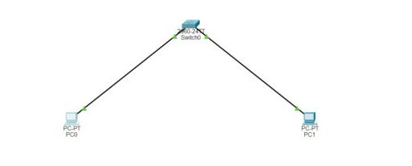
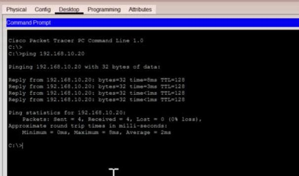

# Lab 1: First LAN

Two PCs, one switch, one network. The simplest setup there is, but it shows how a switch works.

| Device | IP address | Subnet mask | Gateway |
|--------|-----------|-------------|---------|
| PC1 | 192.168.10.10 | 255.255.255.0 | none |
| PC2 | 192.168.10.20 | 255.255.255.0 | none |

I pinged PC2 from PC1 and got 4 out of 4 replies.

**What I took away:**
- A switch moves traffic using MAC addresses, not IPs.
- Before the first ping goes out, PC1 asks the network "who has 192.168.10.20?" (that's ARP). It needs PC2's MAC address before it can send anything.
- No gateway needed, because both PCs are on the same network.

## Project file

[Open or download the Packet Tracer project](JohnAcosta_Lab01_FirstLAN.pkt). Use Cisco Packet Tracer 9.0.1, the version recorded for these labs.

[Back to lab index](../README.md)
