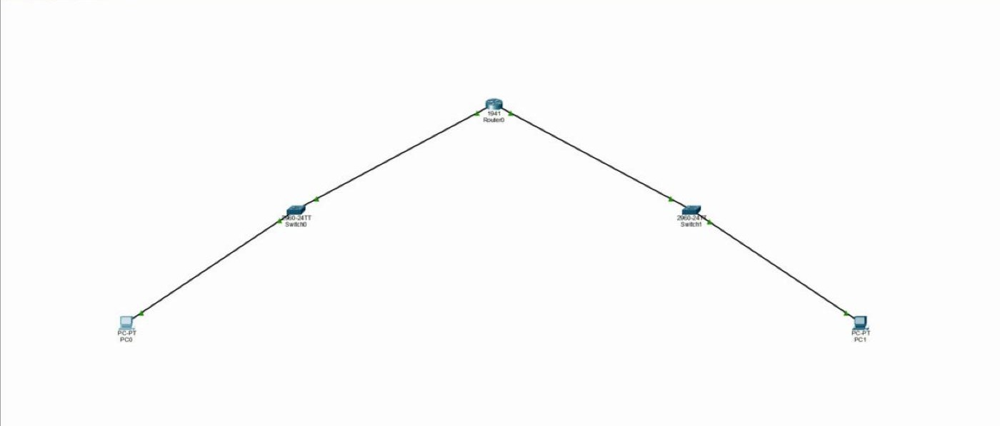
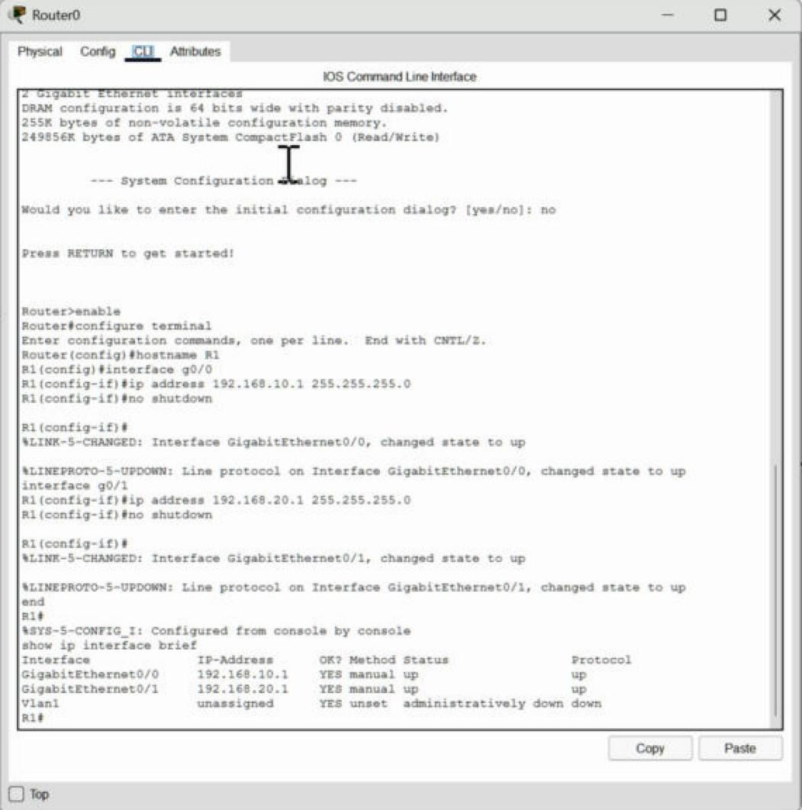
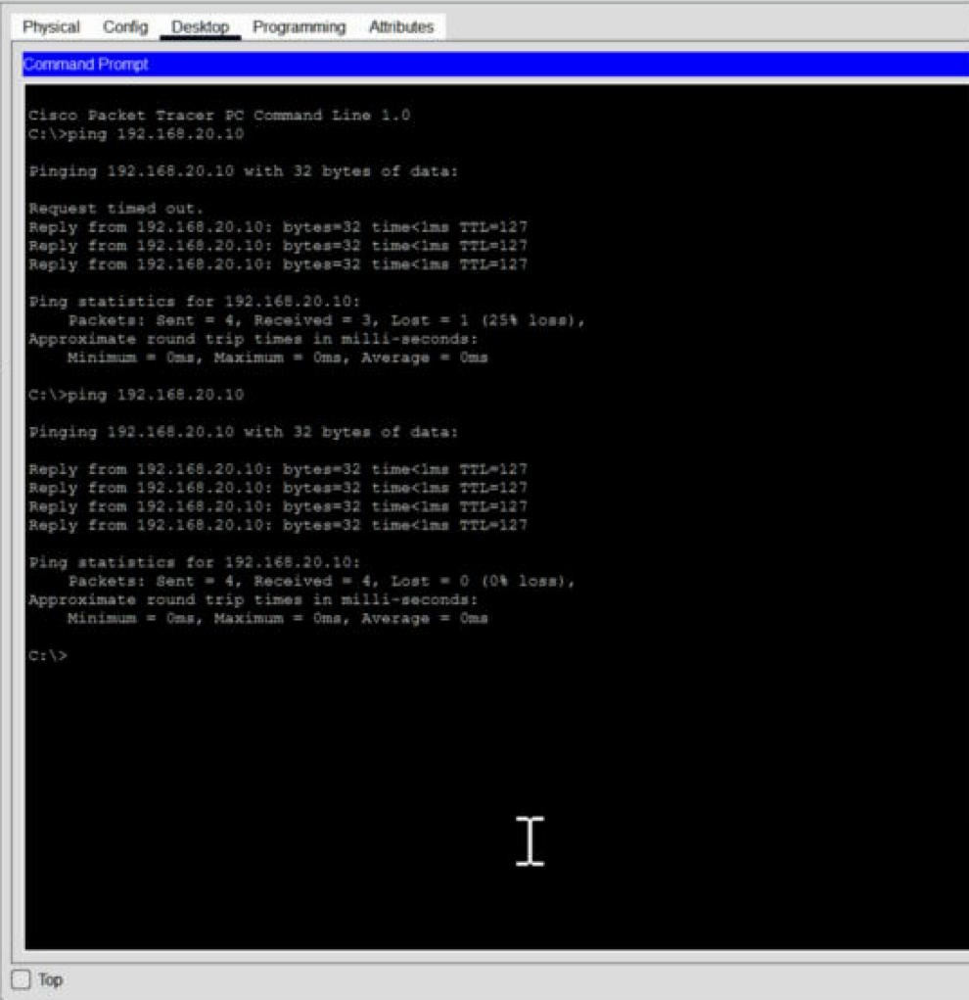

# Lab 2: Two LANs connected by a router

Two classrooms, each on its own network (192.168.10.x and 192.168.20.x), joined by a router in the middle.



| Device | Interface | IP address | Gateway |
|--------|-----------|-----------|---------|
| Router | G0/0 (Classroom A side) | 192.168.10.1 | n/a |
| Router | G0/1 (Classroom B side) | 192.168.20.1 | n/a |
| PC1 | Fa0 | 192.168.10.10 | 192.168.10.1 |
| PC2 | Fa0 | 192.168.20.10 | 192.168.20.1 |

The router was set up from its command line:

```
enable
configure terminal
hostname R1
interface g0/0
 ip address 192.168.10.1 255.255.255.0
 no shutdown
interface g0/1
 ip address 192.168.20.1 255.255.255.0
 no shutdown
end
show ip interface brief
```

Both router ports came up:



Then I pinged across the router from PC1 to PC2:



**What I took away:**
- Router ports start turned off. The links stayed red until `no shutdown`. Switch ports don't work that way.
- The default gateway is how a PC reaches anything outside its own network. PC1 can't reach 192.168.20.10 directly, so it hands the packet to the router.
- The first ping dropped one packet while ARP did its thing, then the second run was 4 for 4.
- The replies said TTL=127 instead of 128 like in Lab 1. The router knocked one off, which proves the packet actually went through it.


## Project file

[Open or download the Packet Tracer project](JohnAcosta_Lab02_TwoLANs.pkt). Use Cisco Packet Tracer 9.0.1, the version recorded for these labs.

[Back to lab index](../README.md)
