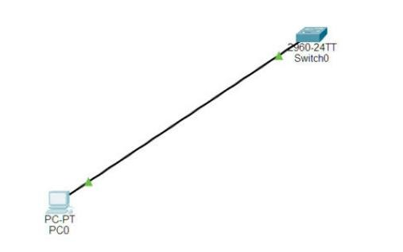
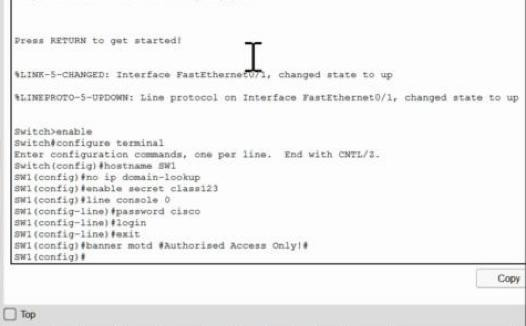
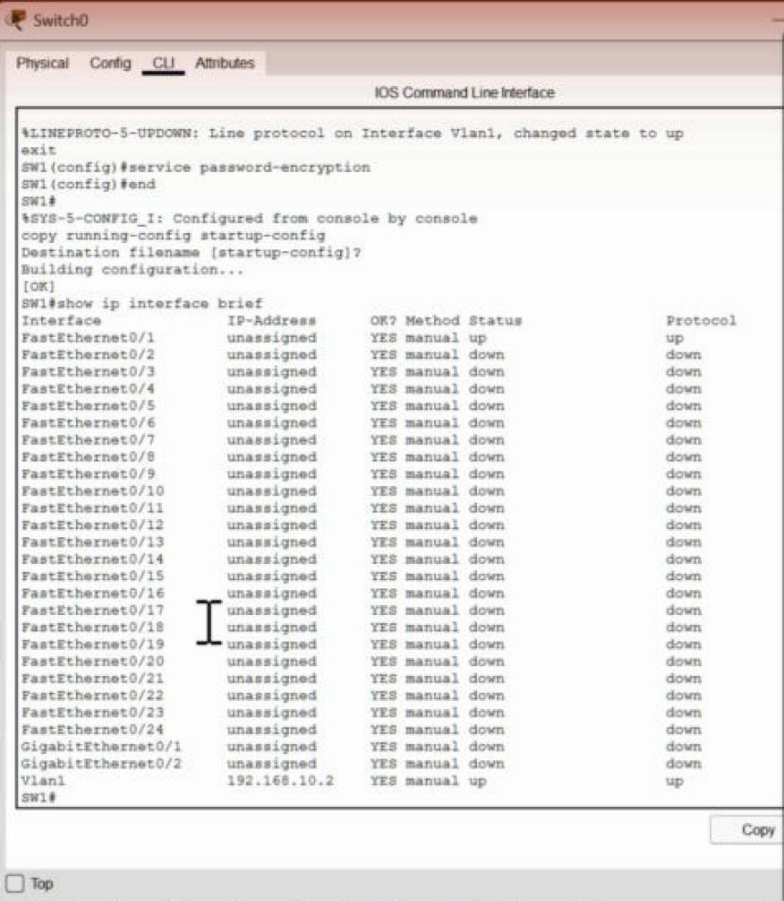
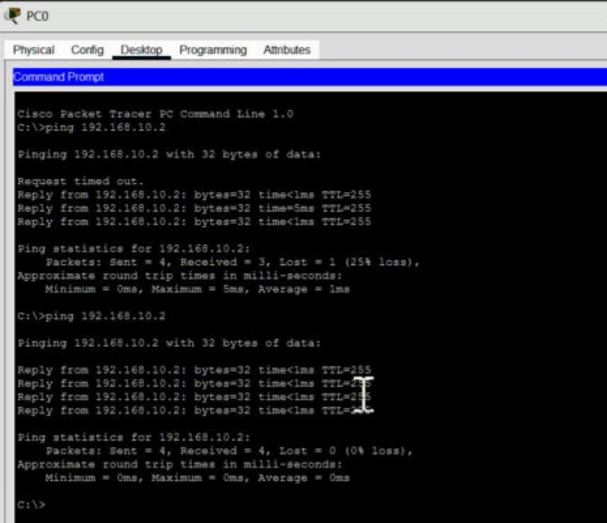

# Lab 3: Switch security baseline

A brand-new switch out of the box has no passwords, no name and no way to manage it over the network. This lab configures basic console and privileged-access protection, assigns a management IP, and verifies IP reachability. SSH and remote login verification are outside the scope of this exercise.



| Device | Interface | IP address | Subnet mask |
|--------|-----------|-----------|-------------|
| SW1 | VLAN 1 (management) | 192.168.10.2 | 255.255.255.0 |
| PC1 | Fa0 | 192.168.10.10 | 255.255.255.0 |

The switch config:

```
enable
configure terminal
hostname SW1
no ip domain-lookup
enable secret class123
line console 0
 password cisco
 login
 exit
banner motd #Authorised Access Only!#
interface vlan 1
 ip address 192.168.10.2 255.255.255.0
 no shutdown
 exit
service password-encryption
end
copy running-config startup-config
```

(These are the lab's practice passwords. Never use passwords like these on a real device.)



VLAN 1 came up with its management address:



Then I pinged the switch itself from PC1, 4 for 4 on the second run:



**What each piece does:**
- `enable secret` puts a password on privileged mode and stores it as a hash. The older `enable password` stores it in plain text, which is why `secret` is preferred.
- `line console 0` + `password` + `login` means anyone plugging a cable into the console port has to log in.
- The banner is the legal "authorised access only" warning shown at login.
- `service password-encryption` scrambles any other passwords in the config file, so they aren't readable over someone's shoulder. It's weak encryption, but better than plain text.
- `no ip domain-lookup` stops the switch from freezing for ages trying to look up a typo as a hostname.
- `interface vlan 1` with an IP is an **SVI** (switched virtual interface). A switch doesn't need an IP to switch traffic, but you need one to reach it remotely for management.

**Running-config vs startup-config:** the running config is what the switch is doing right now, in memory. The startup config is what it loads when it boots. Changes only go into the running config until you run `copy running-config startup-config`. Reboot without saving and all of this is gone.

**Ping detail:** TTL=255 here, not 128 like the PCs. Cisco gear starts its TTL at 255, so the TTL also hints at what kind of device answered.


## Project file

[Open or download the Packet Tracer project](JohnAcosta_Lab03_SwitchBaseline.pkt). Use Cisco Packet Tracer 9.0.1, the version recorded for these labs.

[Back to lab index](../README.md)
