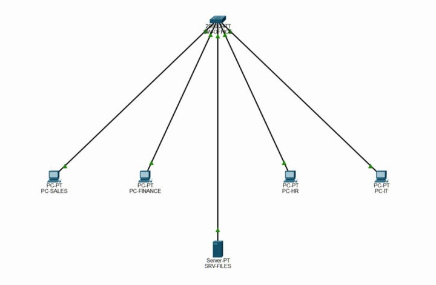
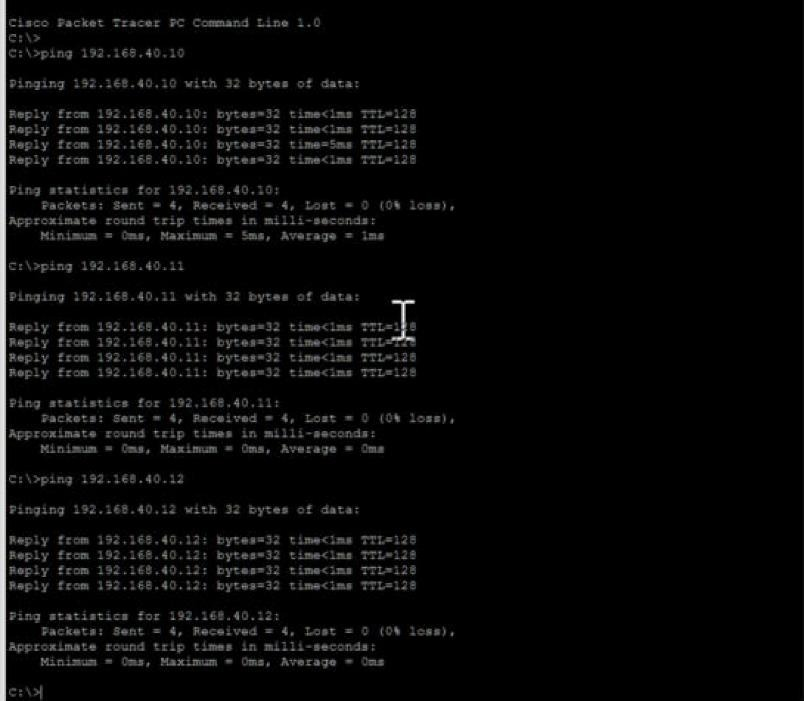
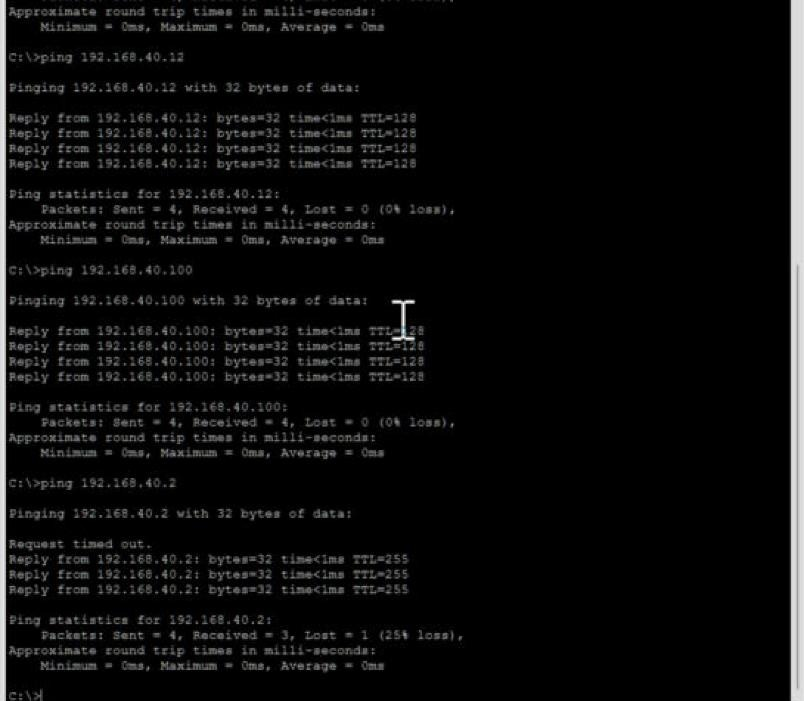
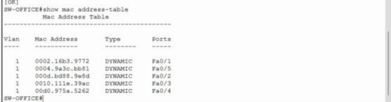

# Lab 4: Small office LAN

A small office: four users (Sales, Finance, HR, IT) and a shared file server, all on one switch and one network. The point of this one is doing the boring stuff properly: real device names, port descriptions, and verifying connectivity from PC-IT to the other four hosts and switch management IP.



| Device | Switch port | IP address | Subnet mask | Gateway |
|--------|-------------|-----------|-------------|---------|
| SW-OFFICE | VLAN 1 (management) | 192.168.40.2 | 255.255.255.0 | 192.168.40.1 |
| PC-SALES | Fa0/1 | 192.168.40.10 | 255.255.255.0 | 192.168.40.1 |
| PC-FINANCE | Fa0/2 | 192.168.40.11 | 255.255.255.0 | 192.168.40.1 |
| PC-HR | Fa0/3 | 192.168.40.12 | 255.255.255.0 | 192.168.40.1 |
| PC-IT | Fa0/4 | 192.168.40.13 | 255.255.255.0 | 192.168.40.1 |
| SRV-FILES | Fa0/5 | 192.168.40.100 | 255.255.255.0 | 192.168.40.1 |

(There's no router in this lab yet. The .1 gateway is reserved for when the office gets one.)

The switch config:

```
enable
configure terminal
hostname SW-OFFICE
no ip domain-lookup
interface vlan 1
 ip address 192.168.40.2 255.255.255.0
 no shutdown
 exit
ip default-gateway 192.168.40.1
interface fa0/1
 description PC-SALES
interface fa0/2
 description PC-FINANCE
interface fa0/3
 description PC-HR
interface fa0/4
 description PC-IT
interface fa0/5
 description SRV-FILES
end
copy running-config startup-config
```

From PC-IT I pinged everything else on the network:

| From PC-IT to | Result |
|---------------|--------|
| PC-SALES (.10) | 4/4 |
| PC-FINANCE (.11) | 4/4 |
| PC-HR (.12) | 4/4 |
| SRV-FILES (.100) | 4/4 |
| SW-OFFICE (.2) | 3/4 (first one lost to ARP) |




Then `show mac address-table` on the switch:



**What I took away:**
- The switch learned all five MAC addresses on its own, one per port, just from the traffic. Every time a frame comes in, the switch writes down "this MAC lives on this port".
- When the switch doesn't know a destination MAC yet, it floods the frame out every port except the one it came in on. Once the reply comes back, it knows where that host is.
- Names and port descriptions sound like busywork until you're troubleshooting at 2am. `description PC-HR` on Fa0/3 tells the next person exactly what's plugged in there, without tracing a cable.


## Project file

[Open or download the Packet Tracer project](JohnAcosta_Lab04_OfficeLAN.pkt). Use Cisco Packet Tracer 9.0.1, the version recorded for these labs.

[Back to lab index](../README.md)
