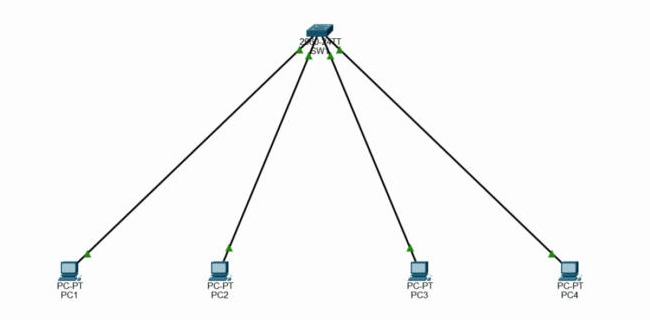
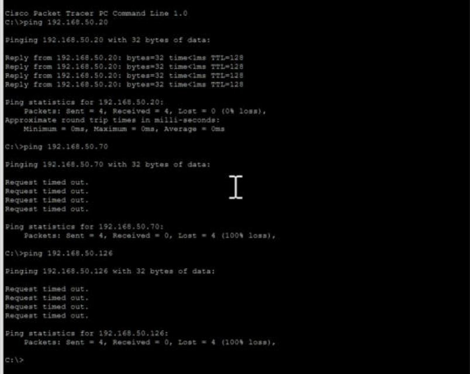
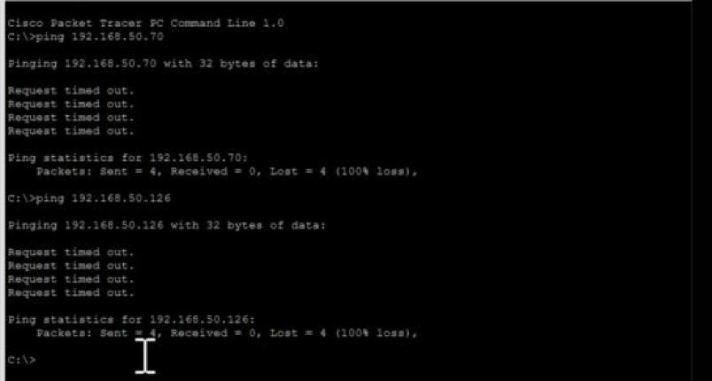
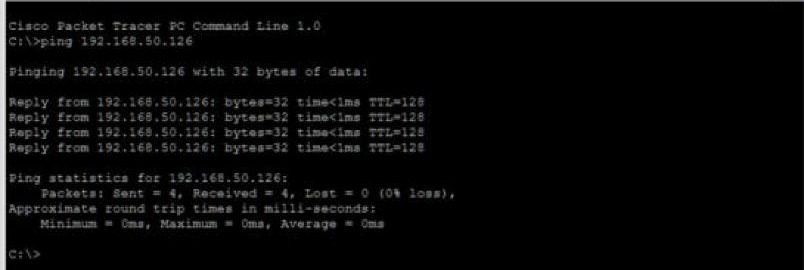
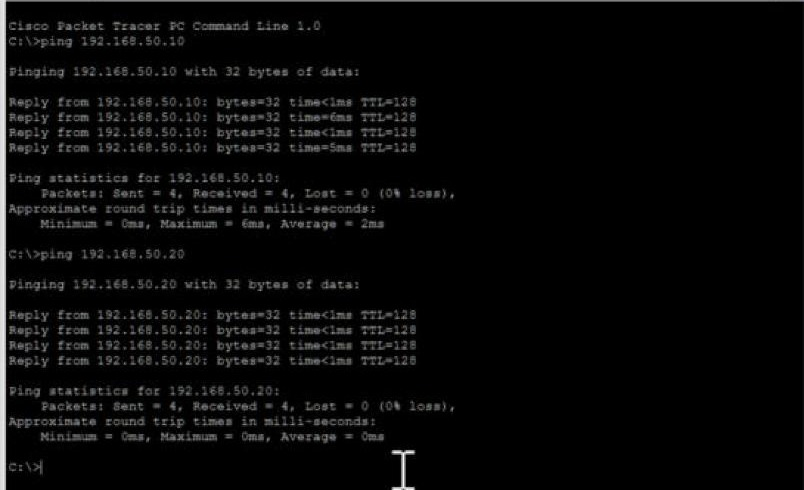

# Lab 5: Subnet investigation

This one is a trap on purpose. A junior tech gave four PCs addresses with a /26 mask (255.255.255.192), all plugged into the same switch. The job: work out on paper which PCs should be able to talk, test it, then fix it.

**Working it out first.** A /26 splits the last number into blocks of 64: .0–.63, .64–.127, .128–.191, .192–.255.

| Host | IP address | Network | Broadcast | Usable hosts |
|------|-----------|---------|-----------|--------------|
| PC1 | 192.168.50.10 | 192.168.50.0 | 192.168.50.63 | .1 – .62 |
| PC2 | 192.168.50.20 | 192.168.50.0 | 192.168.50.63 | .1 – .62 |
| PC3 | 192.168.50.70 | 192.168.50.64 | 192.168.50.127 | .65 – .126 |
| PC4 | 192.168.50.126 | 192.168.50.64 | 192.168.50.127 | .65 – .126 |

So PC1 and PC2 are in one subnet, PC3 and PC4 are in another, and there's no router. Prediction: only PC1↔PC2 and PC3↔PC4 work.

**Testing every pair:**

| Pair | Predicted | Actual |
|------|-----------|--------|
| PC1 ↔ PC2 | works | 4/4 |
| PC1 ↔ PC3 | fails | 0/4 |
| PC1 ↔ PC4 | fails | 0/4 |
| PC2 ↔ PC3 | fails | 0/4 |
| PC2 ↔ PC4 | fails | 0/4 |
| PC3 ↔ PC4 | works | 4/4 |

Every result matched the prediction.

**The fix.** The lab says to move PC4 into PC1 and PC2's subnet without changing the ranges. I gave it **192.168.50.30**: it's inside .1–.62, it isn't the network (.0) or broadcast (.63) address, and nobody else is using it. After the change PC4 reached both PC1 and PC2, 4/4 each:

(Side effect: PC3 is now alone in the .64 subnet, which is fine for this lab. The saved file has the fixed address.)

**What I took away:**
- A /26 has a block size of 64 and 62 usable hosts (64 minus the network and broadcast addresses).
- Hosts on the same switch can still fail to talk. Before sending, a PC checks if the destination is in its own subnet. If it isn't, it tries to use its default gateway, and here there isn't one, so the packet never leaves.
- This is a good QA lesson too: "it's all plugged into the same box" is a physical assumption, and the bug was in the config. Predicting the result before running the test is what made the trap obvious instead of confusing.

## Project file

[Open or download the Packet Tracer project](JohnAcosta_Lab05_SubnetInvestigation.pkt). Use Cisco Packet Tracer 9.0.1, the version recorded for these labs.

[Back to lab index](../README.md)
